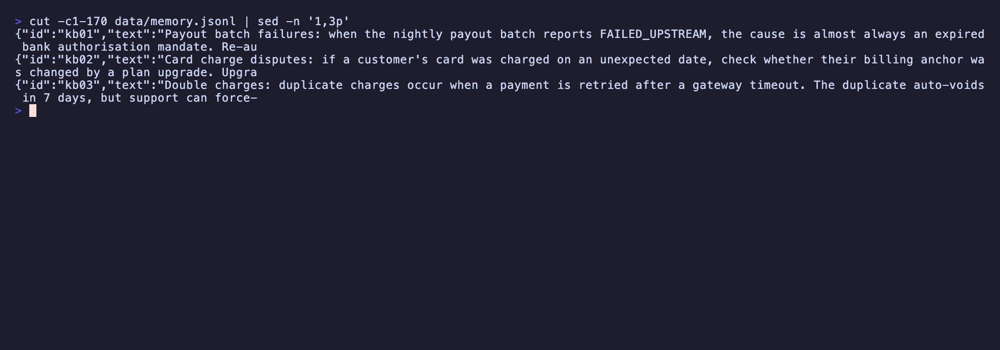
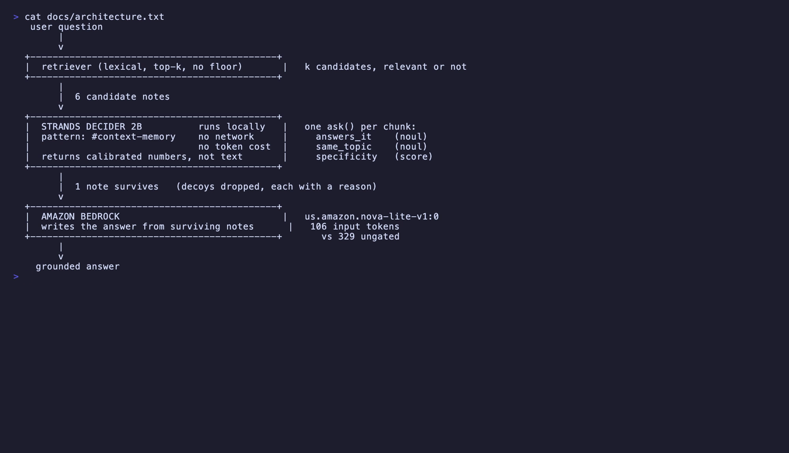
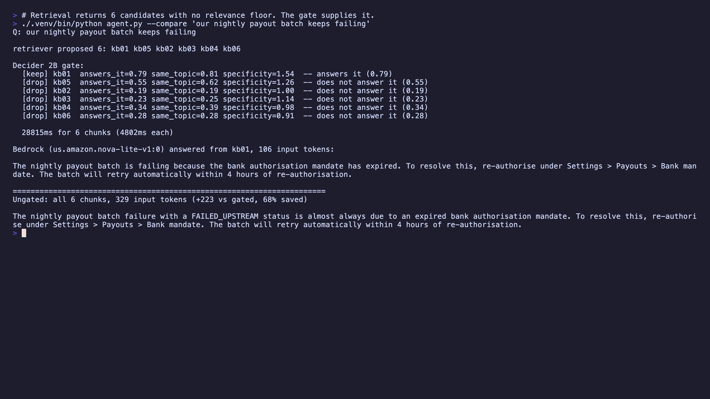
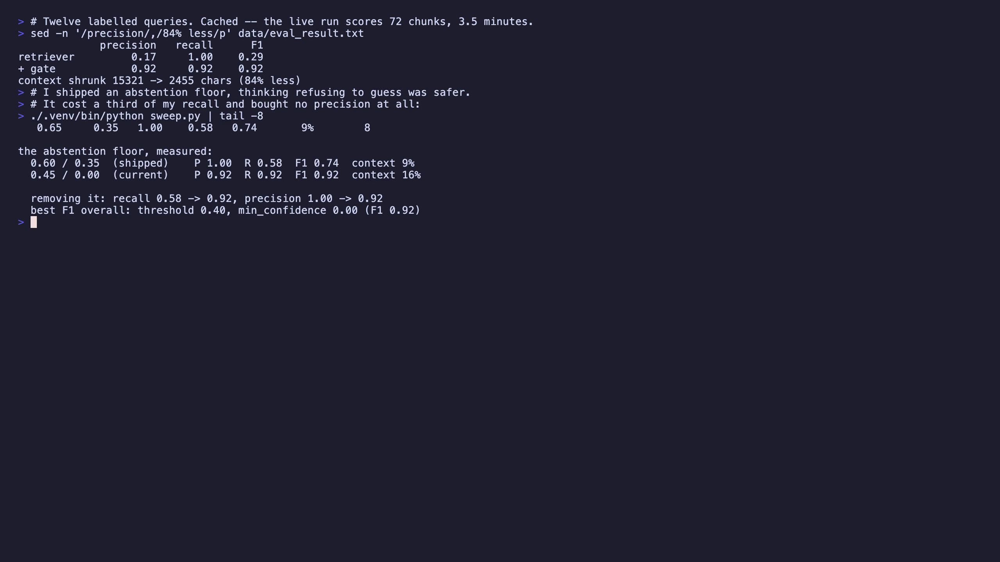
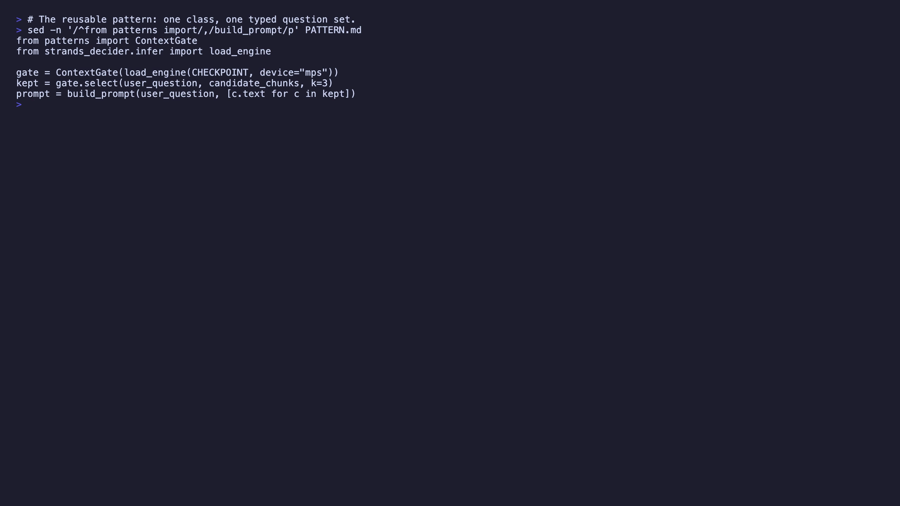
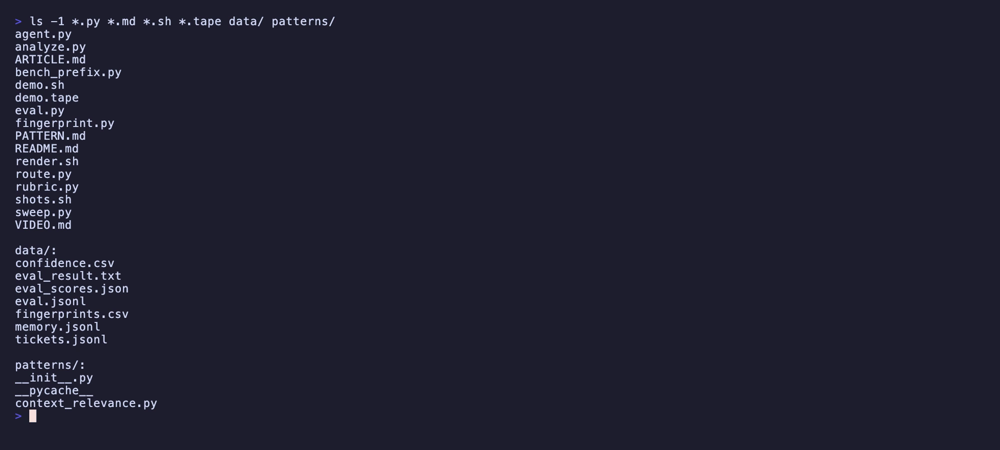
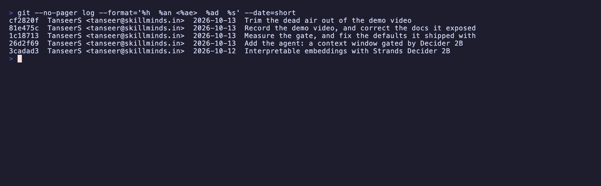

# I let a 2B model decide what my agent is allowed to remember

**Tags:** `#strands-decider-2b` `#context-memory`

| | |
|---|---|
| **Decision pattern** | Context and memory — score which chunks are relevant before injecting them |
| **Decision model** | [Strands Decider 2B](https://huggingface.co/StrandsAgents/strands-decider-2B-hobson-v19) (`hobson-v19`), running locally |
| **Generative model** | [Amazon Bedrock](https://aws.amazon.com/bedrock/) — `us.amazon.nova-lite-v1:0` |
| **Repository** | https://github.com/TanseerS/strands-decider |
| **Demo video** | *(paste your upload link here)* |

---

Retrieval is good at finding notes that are *about* your question. It is bad at
finding notes that *answer* it. Those are different things, and the gap between
them is where RAG agents quietly go wrong.

Here are three notes from my agent's memory:



> **kb01** — Payout batch failures: when the nightly payout batch reports
> FAILED_UPSTREAM, the cause is almost always an expired bank authorisation
> mandate.
>
> **kb02** — Card charge disputes: if a customer's card was charged on an
> unexpected date, check whether their billing anchor was changed by a plan
> upgrade.
>
> **kb03** — Double charges: duplicate charges occur when a payment is retried
> after a gateway timeout.

Now ask: *our nightly payout batch keeps failing*.

All three come back. They share a vocabulary — payment, charge, billing, failure —
and they are all genuinely about money moving incorrectly. An embedding model is
not malfunctioning when it ranks them together. They really are similar. Only one
answers the question.

You cannot fix this with a better similarity metric, because similarity is not the
thing you want to measure. The question you actually want answered is *does this
note answer this question*, and that is a typed decision, not a distance.

So I handed that decision to [Strands Decider 2B](https://strandsagents.com/blog/introducing-strands-decider/).

## What the agent does

A support agent that answers customer questions from a memory store of internal
notes. Retrieval proposes, Decider 2B disposes, Bedrock writes the answer.



The retriever deliberately has no relevance floor, because that is how top-k
vector search behaves: it always hands back k candidates, relevant or not.
Supplying that floor is the gate's job.

## The decision I handed to Decider 2B

One `ask()` per candidate chunk, three typed axes:

| Axis | Type | Role |
|---|---|---|
| `answers_it` | noul | The decision. Calibrated probability the note answers the question. |
| `same_topic` | noul | Catches same-domain, different-problem decoys. |
| `specificity` | score | Diagnostic: vague background → concrete procedure. |

The state is the question and the candidate note, with an instruction to decide
whether the note should be handed to an assistant about to answer:

```
USER QUESTION:
{query}

REFERENCE NOTE:
{chunk}

Decide whether this reference note should be given to an assistant that is
about to answer the user's question.
```

Decider 2B does not write anything. It returns numbers. That turns out to be
exactly what you want from a component sitting in your retrieval path: it cannot
hallucinate a justification, it cannot be talked into saying "yes, this note is
relevant", and its output goes straight into an `if`.

## It working

On the payout question the gate keeps **1 of 6** chunks and drops every decoy,
with a reason attached to each decision:



```
[keep] kb01  answers_it=0.79 same_topic=0.81  -- answers it (0.79)
[drop] kb05  answers_it=0.55 same_topic=0.62  -- does not answer it (0.55)
[drop] kb04  answers_it=0.34 same_topic=0.39  -- does not answer it (0.34)
[drop] kb03  answers_it=0.23 same_topic=0.25  -- does not answer it (0.23)
[drop] kb02  answers_it=0.19 same_topic=0.19  -- does not answer it (0.19)

Bedrock answered from kb01, 106 input tokens
Ungated: all 6 chunks, 329 input tokens (68% fewer)
```

Both answers are correct here. The gated one just costs a third as much and cannot
be led astray by kb02. On a larger memory store, where decoys outnumber the answer,
that second property matters more than the tokens.

## What I got wrong

I shipped the gate with `threshold=0.6` and an abstention floor of
`min_confidence=0.35`, reasoning that a gate which refuses to guess is safer than
one that guesses. Dropping is the safe direction, after all: a missing note makes
the agent say "I don't know", while a wrong note makes it answer confidently and
wrongly.

Then I wrote twelve labelled queries and measured it.



```
             precision   recall    F1
retriever         0.17     1.00   0.29
+ gate            1.00     0.58   0.74
```

Perfect precision — and it threw away **five of twelve correct answers**. Four of
those were abstentions. The gate had looked at the right note, felt unsure, and
binned it.

Because I cached the raw scores, I could sweep the thresholds offline in
milliseconds instead of re-running a 2B model twenty-four times:


```
thresh  minconf   prec  recall     F1  context
  0.45     0.00   0.92    0.92   0.92      16%
  0.45     0.10   1.00    0.83   0.91      13%
  0.60     0.35   1.00    0.58   0.74       9%   <- what I shipped
```

**The abstention floor was pure loss.** Turning it off took F1 from 0.74 to 0.92.
It bought no extra precision, because the chunks it suppressed were ones the
threshold already handled correctly — it was vetoing decisions that were about to
be right.

The lesson I did not expect: *abstention is not free safety.* It feels prudent, it
reads well in a design doc, and on this corpus it cost a third of my recall in
exchange for nothing. The only way I found out was by labelling twelve examples,
which took about ten minutes.

The gate now defaults to `threshold=0.45, min_confidence=0.0`, and ships with
`sweep.py` so nobody has to inherit my guess.

## Why calibration is the thing

A threshold on an uncalibrated score is a magic number you re-tune per dataset. A
threshold on a *calibrated* probability means the same thing across corpora,
because the model was trained so that 0.8 actually means 0.8.

That is what makes this reusable as a pattern rather than as my code. You can take
`ContextGate`, point it at your own notes, and 0.45 still means something. You
should still sweep it — but you are tuning, not guessing from scratch.

## The reusable pattern

[`patterns/context_relevance.py`](https://github.com/TanseerS/strands-decider/blob/main/patterns/context_relevance.py)
is one class and one typed question set.



```python
from patterns import ContextGate
from strands_decider.infer import load_engine

gate = ContextGate(load_engine(CHECKPOINT, device="mps"))
kept = gate.select(user_question, candidate_chunks, k=3)
prompt = build_prompt(user_question, [c.text for c in kept])
```

Any object exposing `.ask(state, questions)` works as the engine. Chunks need only
`.id` and `.text`. For a [Strands Agents](https://strandsagents.com) agent, call
`select()` from an `InterventionHandler` before the model call, or in your
retriever's post-processing step. Every decision comes back as a `GateResult`
carrying its score, its confidence and a human-readable reason, so the agent can
explain its own context window.

Full usage notes: [`PATTERN.md`](https://github.com/TanseerS/strands-decider/blob/main/PATTERN.md).

## Honest limits

- **Twelve queries is not an eval.** It is enough to catch a mistuned threshold —
  which it did, decisively — and not enough to claim an accuracy number. The notes
  and the decoys are both mine.
- **Latency is real.** ~2.1 s per chunk decision on an M1, six chunks per query.
  The [launch post](https://strandsagents.com/blog/introducing-strands-decider/)
  reports ~115 ms on a 3090. On a laptop this is a batch-shaped gate, not a hot
  path. It costs wall-clock to save tokens and avoid wrong context, and whether
  that trade is worth it depends on your hardware.
- **One note still gets rejected outright** at the new settings, not abstained:
  kb03 scores 0.27 on "we were charged twice for the same annual plan" despite
  being exactly right. I do not have a good explanation for that one yet.

## Running it



```sh
git clone https://github.com/TanseerS/strands-decider
cd strands-decider
uv venv --python 3.12 .venv
uv pip install --python .venv/bin/python -r requirements.txt

python agent.py --compare "our nightly payout batch keeps failing"
python eval.py        # labelled eval, caches raw scores
python sweep.py       # find your own operating point
```

Decider 2B runs locally and needs no AWS access. Bedrock needs credentials with
`bedrock:InvokeModel` in `us-east-1`.

## Build log



Repository: https://github.com/TanseerS/strands-decider
